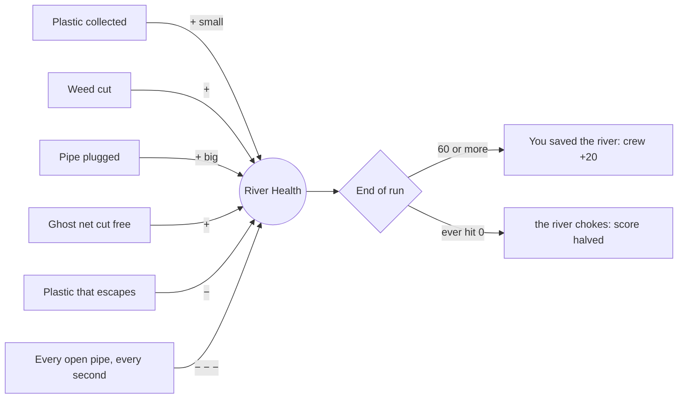
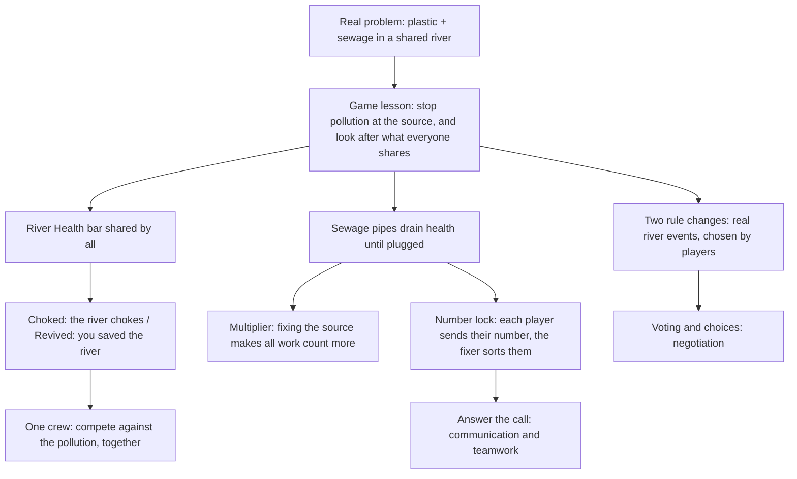

# Clearwater Run, explained from the start

This guide is for someone who has never seen the game. It starts with the real-world problem, then the
assignment, then walks through every feature: **what it is, why it is there, and what it teaches.** No game
experience is needed.

> **Where the exact numbers live:** the [Rule Book](RULE_BOOK.md) has every rule and number for players. The
> [Game Design Document](GAME_DESIGN.md) has the design reasoning. This guide explains the *ideas*.

---

## Contents

1. [The real problem: rivers choking on plastic and sewage](#1-the-real-problem-rivers-choking-on-plastic-and-sewage)
2. [The assignment, and how the game answers it](#2-the-assignment-and-how-the-game-answers-it)
3. [The game in one minute](#3-the-game-in-one-minute)
4. [What you see on screen](#4-what-you-see-on-screen)
5. [River Health: the most important idea](#5-river-health-the-most-important-idea)
6. [Everything on the river, and why it is there](#6-everything-on-the-river-and-why-it-is-there)
7. [The sewage pipe, explained properly](#7-the-sewage-pipe-explained-properly)
8. [Pipe numbers](#8-pipe-numbers)
9. [One crew against the pollution](#9-one-crew-against-the-pollution)
10. [The two rule changes](#10-the-two-rule-changes)
11. [Score: how points work](#11-score-how-points-work)
12. [Capsizing, boost and other boats](#12-capsizing-boost-and-other-boats)
13. [The three rivers](#13-the-three-rivers)
14. [Around the game: hub, Seeds, boats, stars, missions, ranks](#14-around-the-game-hub-seeds-boats-stars-missions-ranks)
15. [Endless](#15-endless)
16. [Tutorial, settings and controls](#16-tutorial-settings-and-controls)
17. [Behind the scenes: the River Director (creator only)](#17-behind-the-scenes-the-river-director-creator-only)
18. [How it all fits together](#18-how-it-all-fits-together)
19. [Glossary](#19-glossary)
20. [Questions people ask](#20-questions-people-ask)

---

## 1. The real problem: rivers choking on plastic and sewage

Many rivers that flow through big, fast-growing cities face the same two problems.

**Plastic waste.** Bottles, bags and wrappers are dropped in streets and drains. Rain washes them into the river,
and the river carries them downstream to the sea. Plastic does not rot: it breaks into smaller and smaller pieces
that fish and birds swallow.

**Untreated sewage.** Cities produce huge amounts of waste water from toilets, kitchens and factories. Where there
are not enough treatment plants, or the pipes are broken or illegal, that waste water flows **straight into the
river through outfall pipes** in the riverbank. Sewage:
- uses up the oxygen in the water, so fish suffocate;
- feeds fast-growing weeds such as water hyacinth, which cover the surface and block sunlight;
- makes the water smell, look brown and spread disease.

**Why it keeps happening.** Everyone shares the river, but nobody owns it. Each person, business or town gains a
little by dumping waste ("someone else will deal with it"), and the cost is spread over everyone. When everyone
thinks that way, the river dies, and *everyone* loses. Economists call this the **tragedy of the commons**.

**The key insight the game is built on:** picking up plastic helps, but it is only cleaning up the *symptoms*. The
real fix is to **stop the pollution at its source**: plug the sewage pipes and stop new waste getting in. Cleaning
a river without stopping the pipes is like mopping the floor with the tap still running.

The game uses **no real place names**. It shows the problem in general; the presentation can connect it to a real
river.

---

## 2. The assignment, and how the game answers it

The brief asked for a game about **environmental awareness**, addressed **indirectly** (not a lecture), where:
- players **change the rules exactly twice** while playing;
- there is **cooperation, communication and negotiation**;
- there are **puzzles**;
- the rules are **simple**;
- the number of players is **limited**.

| The brief says | How Clearwater Run does it |
|---|---|
| Environmental awareness, indirectly | You never read a lecture. You *feel* the problem: missed plastic and open pipes make the shared river sicker, and a dead river cuts everyone's score in half. |
| Players change the rules exactly twice | Every run has a **Twist** and a **Finale**, both voted by the crew. The game enforces exactly two. |
| Cooperation | Everyone is **one crew** with one score and one River Health bar, playing together against the pollution, the pollution. |
| Communication | Each player gets a number for each pipe and chooses to send it. The fixer calls out "press your number!" and needs at least one crewmate's number. |
| Negotiation | Both rule changes are crew votes, argued out loud ("points now, or protect the river?"). Crews also plan who fixes which pipe. |
| Puzzles | The number lock: put the crew's numbers in increasing order, fast, while still steering; alone, three numbers smallest first. |
| Competition (without fighting friends) | The crew competes against the pollution, against its own best scores and stars, and for Endless records. |
| Simple rules | Three buttons: steer, hop, action. A 60-second tutorial teaches everything. |
| Limited players | 1–4 players per room. |

---

## 3. The game in one minute

- You drive a small **cleanup boat** down a river. The boat moves forward **on its own**; you only steer left and
  right, **hop**, and press one **action** button.
- A run lasts **3 minutes**.
- You **collect plastic** by driving into it. You **cut weed**, **hop over logs**, and **plug sewage pipes**.
- There is one shared **River Health** bar for everybody. Pollution lowers it; cleaning raises it.
- Everyone in the room is **one crew** against the pollution (a grumpy smog cloud over every open pipe). You win together by
  keeping the river alive.
- Twice per run, the players **change the rules**.
- At the end: scores, River Health, stars, and **Seeds** (the game's coins) to spend on boats.

---

## 4. What you see on screen

```
┌──────────────────────────────────────────────────────────────┐
│ YOUR CREW 37        2:14               RIVER HEALTH ████░ 72% │  ← score · timer · shared health
│ ♻ 30 · 🔧 1        Monsoon Surge                              │  ← plastic · pipes · active rule
│                                                              │
│                🔧 Sewage pipe ahead on the LEFT              │  ← prompts
│                                                              │
│                     ~ ~ river ahead ~ ~                       │
│                                                              │
│                        [ your boat ]                         │
│                                                              │
│ ◀ ▶ steer · ▲ hop      [ Boost ███░░ ]                        │
└──────────────────────────────────────────────────────────────┘
```

- **Top left:** your crew's score, with plastic collected (♻) and pipes plugged (🔧) under it.
- **Top middle:** time left, and a badge for any rule change in force.
- **Top right:** **River Health**, shared by everyone on the river.
- **Middle:** helpful prompts ("pipe ahead", "debris wave ahead").
- **Bottom middle:** your **boost meter**.
- **Just above the boost meter:** your big **pipe number** when one is dealt. On a phone, thumb buttons also appear.

---

## 5. River Health: the most important idea

River Health is **one bar, shared by every player**, from 0 to 100. It starts at 70.



**Why it exists.** It turns the "tragedy of the commons" into a rule you can feel. A crew that only chases
plastic and ignores the pipes watches the river choke, and its score is cut in half. A crew that looks after
the river gets the +20 bonus. On screen the bar is labelled **River health**: the empty part is muddy brown.

**What it teaches.** A shared resource only survives if someone pays attention to it.

You can also *see* the health: the water turns from clear blue-green to murky brown as it drops.

---

## 6. Everything on the river, and why it is there

| Thing | What it does in the game | What to do | Why it is in the game |
|---|---|---|---|
| **Plastic** (bottles, bags) | +1 crew score, fills your boost, heals the river a little. If *every* boat passes it, it escapes downstream and hurts the river. | Drive into it. | The visible, everyday pollution. Picking it up is good, but small. |
| **Weed mat** (floating water weed with purple flowers) | Slows you down if you hit it. | Press **Action** just before it to cut it. Each cut "greens a bank": +5 score and the river heals. | Real sewage feeds weeds like water hyacinth that choke rivers. Clearing them helps the river breathe. |
| **Log** | Capsizes you (you stop briefly and spill plastic). A red shadow appears under a log in your lane when it's time to hop. | **Hop** over it. | A simple obstacle that makes steering and timing matter. |
| **Debris wave** (every 30 s) | A wall of floating junk across every lane but one (two gaps on a wide river). The gaps glow. | Steer to a gap, or hop. | Like the junk a storm or flood sweeps down a river. It forces quick decisions. |
| **Sewage pipe** (in the riverbank) | Pours brown murk and drains River Health **every second** until someone plugs it. | Pull up beside it, press **Action**, enter the **gate code**. | The source of the pollution. See the next section. |

---

## 7. The sewage pipe, explained properly

This is the heart of the game, so it gets its own section.

### What it is

Along the riverbanks there are **concrete outfall pipes**, like the real pipes that dump untreated sewage into
city rivers. In the game you see a grey pipe sticking out of the bank with a **brown plume** spreading into the
water.

### What it does

As soon as the leading boat comes within about 30 metres of it, **each open pipe drains River Health a little every
second**, and it keeps
draining until someone plugs it. Two open pipes drain twice as fast. Pipes never stop by themselves.

### Why it is in the game

Without pipes, the game would only be about collecting plastic, which teaches "cleaning up is enough". The pipe
adds the real lesson:

> **Stop pollution at its source, or the river never gets better.**

You can collect plastic all run long, but if pipes stay open, River Health keeps falling underneath you. Plugging a
pipe is the single biggest thing you can do for the river (+10 health at once, and it stops the drain for good).

### Why plugging is worth so many points

Each pipe your crew plugs raises your crew's **multiplier** for the rest of the run:

```
Crew score = plastic × (1 + 0.5 × pipes plugged) + 5 × banks greened
```

So with 1 pipe plugged, every piece of plastic is worth 1.5 points; with 2 pipes, 2 points. **Fixing the source
makes all your other work count for more.** That is the real-world idea in game form: stopping pollution at the
source makes every clean-up effort more effective.

### How you plug a pipe

1. **Spot it.** Open pipes have a big brown plume, a grumpy smog cloud above them, and a floating 🔧 marker with the
   distance. A card at the top of the screen says which bank (◀ LEFT or RIGHT ▶), how many metres away, and your
   next step. With friends, the marker also suggests whose turn it is ("Asha's turn?").
2. **Get beside it.** Steer into the **outermost lane** on that side ("Move ◀ left to the edge lane").
3. **Press Action** when you're next to it ("Press ▼ NOW to plug it!"). Your boat **stops**, and the lock opens.
4. **Fill the lock** (below), then the boat stays put **one more second** while your crew member hammers the pipe
   shut (sparks and clanks). the smog cloud leaves, River Health +10, and a banner shows your new multiplier ("every plastic
   now ×1.5"). The ×1.5 badge stays next to your score.
5. **Failed:** the river takes a hit (River Health −5) and the pipe keeps pouring. You can try again with new numbers.
6. **Changed your mind?** Press **▲ (hop)** to leave the lock and sail on, with no penalty.

### The number lock: see it, press it, the fixer sorts it

As the crew nears a pipe (about 90 m), **every player gets a big number from 1 to 9** on their own screen, different
for each player. It stays for 8 seconds and **blinks** as it is about to go. Nothing to remember: **press it** (or tap
it) and it is sent. That press is your choice to help fix the pipe; the card turns into "✔ Your 7 is in".

When someone presses Action at the pipe, they become the **fixer**. Their lock shows their own number and **every
number the crew has sent**, under each player's name. Anyone who hasn't pressed yet sees their number come back,
blinking: "Your crew needs it!". The fixer types the numbers **smallest first** within **12 seconds**. It needs at
least **one crewmate's number** on top of their own.

**Nobody can fix a pipe alone**: the fixer needs a crewmate who chose to press. That's the teamwork, and the talking:
"Press your number!"

#### Worked example: Ben, You and Asha

| Step | You (the fixer) | Ben and Asha |
|---|---|---|
| 1 | Your number: **6**. | Ben gets **1**. Asha gets **3**. |
| 2 | Press **6** (or don't: it's on your lock anyway). | Ben presses **1**. Asha is dodging a log. |
| 3 | Press **Action** beside the pipe. The lock shows Ben **1** · You **6** · Asha … | Asha's **3** comes back, blinking. She presses it. |
| 4 | Type smallest first: **1, 3, 6**. | Keep sailing. |
| 5 | Fixed! River +10, every plastic now ×1.5. | Same score boost for everyone. |

**Several fixers.** Two or more players can open a lock at the same pipe; sent numbers show on all of them, and the
**first** to finish fixes it. Crews choose their plan: everyone stops for a lightning fix, or one fixer stays behind
(the others press ▲ and sail on) while the rest keep collecting. A boat that falls more than 25 m behind gets a
**catch-up current** (+15 % speed), so nobody is stranded.

**Playing alone.** The lock shows three numbers (say 7 · 2 · 5); type them smallest first (2, 5, 7) within
8 seconds. They stay on screen.

### Why the code works this way

This is the game's **puzzle** and its **communication** requirement in one. It also mirrors real life: fixing
pollution at the source is never a one-person job. It needs people **coordinating**: inspectors, councils,
engineers, communities, each holding a piece. If nobody answers the call, the fix fails and the river suffers.

### The trade-off it creates

While you plug a pipe, your boat is **stopped**, and your teammates have to answer your call instead of only
racing ahead. So every crew faces a real choice:
- **chase points now** (collect plastic), or
- **invest in the river** (plug the pipe), which pays back through the multiplier and protects the shared health
  bar.

That choice, "short-term gain or long-term fix", is exactly the choice people face with real pollution.

---

## 8. Pipe numbers

- Plain digits **1–9**: no symbols to learn, so anyone can play, at any age.
- Your number is **yours alone**; only the fixer sees the numbers that were sent.
- Keyboard: keys 1–9. Phone: tap the big number (and the numbers on a lock). Gamepad: hold RT and press A/B/X/Y/LB/RB
  for the 1st–6th number on screen.

---

## 9. One crew against the pollution

| Players | Crew |
|---|---|
| 1 | You alone, against the pollution. |
| 2–4 | **Everyone in one crew**, against the pollution. |

- The crew **shares one score**, one River Health bar and one result.
- A grumpy brown smog cloud (silly, never scary) sulks over every open sewage pipe and vanishes when you plug it.
- **You saved the river** when the river ends revived. **the river chokes** if it chokes.

**Why one crew?** The brief asked for teamwork and no violence. Instead of friends fighting each other for points,
the whole room works together against the real enemy, pollution. There is still competition: against the pollution, against
your crew's best scores and stars, and for Endless records.

---

## 10. The two rule changes

Every run, the rules change **exactly twice**, and **players choose** both changes. Each one goes:
a 5-second warning → the game pauses → you choose → a card shows the new rule → racing resumes.

### Rule change 1: the Twist (about 1 minute in). Everyone votes.

| Twist | Good side | Bad side | Real-world idea |
|---|---|---|---|
| **Monsoon Surge** | Extra plastic to collect | Debris waves every 15 s instead of 30 s | Heavy rain washes far more waste into rivers |
| **Dry Season** | Fewer lanes to watch | A third of the lanes dry up, and pipes pour twice as fast | Low water concentrates pollution, so sewage does more damage |
| **Volunteer Day** | Each plastic counts double | Weed mats keep spreading | Community clean-ups make a big difference, but nature fights back |

A tie goes to **whoever voted first** (the result card says who), so everyone always gets the same river. Only if nobody votes at all does the river pick at random, with a visible spin.

**Why a vote?** It's the **negotiation** part of the brief. Players argue out loud: "Dry Season will kill us, we
haven't plugged a pipe!" Different players want different twists depending on how they play.

### Rule change 2: the Finale (about 2:20 in). The crew votes again.

| Finale | What it does |
|---|---|
| **Second Wind** | Every boat's boost fills up, and extra plastic flows your way for 20 s. Good for a late score push. |
| **Clean Sweep** | Every open pipe pours at half speed for the rest of the run. Good for saving the river from pollution. |

**Why it's a real choice:** points now (Second Wind) or a safer river (Clean Sweep)? If River Health is low, Clean
Sweep may be what saves the river.

**What never changes:** the controls, the score formula and how you win. Only the river changes.

---

## 11. Score: how points work

```
Crew score = plastic × (1 + 0.5 × pipes plugged) + 5 × banks greened
```

**Example:** 40 plastic, 2 pipes plugged, 3 weed mats cut → 40 × 2 + 15 = **95**.

At the end:
- River Health 60 or more → **you saved the river**: +20 for the crew (revived).
- River Health ever hit 0 → **the river chokes**: the score is **halved** (choked).
- The results also show how many pipes each player fixed.

---

## 12. Capsizing, boost and other boats

**Capsize.** Hit a log or a debris wave without hopping, and your boat **flips over**:
- you stop for about **a second**;
- you **spill 3 plastic** just ahead of you, which anyone (including you) can collect again;
- then for **1 second** obstacles pass through you (your boat blinks), so you can't be knocked over twice in a row.

There's a short freeze, a screen shake and a red flash so it *feels* like a hit; these can be toned down in
Settings → Comfort.

*Why it works like this:* earlier versions stopped you for 2 seconds, which felt like a harsh punishment. Now it's
short, but costs you something you can win back, so a mistake stings without ruining your run.

**Boost.** Every piece of plastic fills your boost meter. When it's full, your boat **surges forward at 1.5× speed**
for 2.5 seconds, and weed can't slow you. *Why:* it rewards collecting with a fun burst of speed.

**Other boats.** If you run into the back of a boat in your lane, you slow down briefly. There is no attacking or
crashing into each other on purpose: the game has **no violence**.

**A wider river with more players.** One boat gets 3 lanes, 2 boats get 4, and 3–4 boats get 6. Wider rivers also
carry more plastic and more obstacles, so everyone has room and enough to collect.

---

## 13. The three rivers

Each river adds **one new thing** on top of everything before it. You choose the river from the button above PLAY
(in a crew room, the host chooses).

### Town Canal (available from the start)
Everything above: plastic, weed, logs, waves and pipes, between houses and footbridges.

### Mangrove Maze (unlocks after 3 runs or 3 stars)
- **New: ghost nets.** Old, abandoned fishing nets floating across **two lanes**, with plastic trapped inside.
- Hitting one slows you, like weed.
- Press **Action** **twice** to cut it free, or have a crewmate press once too. It releases 4 pieces of plastic and
  heals the river.
- **Real-world idea:** "ghost gear" (lost or dumped fishing nets) is one of the deadliest kinds of plastic in water.
  It keeps trapping fish and wildlife for years.
- **Why two cuts:** it encourages crewmates to work together on the same net.

### Rapids Gorge (unlocks after 8 runs or 7 stars)
- **New: currents.** White arrows on the water that **push your boat one lane sideways**, unless you hop over them.
- **New: rocks.** Like logs, but you **can't hop** them: you must steer around.
- **Why:** fast water is harder to control. It tests skill, and pairs nicely: a current might push you towards a
  rock.

Two more rivers (Night Delta and Harbour Port) are designed for later.

---

## 14. Around the game: hub, Seeds, boats, stars, missions, ranks

The **hub** is the main menu: a big PLAY button, side tiles, and your Seeds.

| Feature | What it is | Why it is there |
|---|---|---|
| **PLAY** | Opens a crew room with a 6-letter invitation code. Friends type it to join. | How multiplayer starts. |
| **Practice solo** | A run on your own. Pays half Seeds. | Learn and improve without friends online. |
| **∞ Endless** | A solo survival mode (section 15). | A personal-best challenge. |
| **Seeds** 🌱 | The only currency. **Earned by playing, never bought.** | Reward without unfairness: no real money anywhere. |
| **Garage** | Choose which boat you sail. | Personal style and small upgrades. |
| **Shop** | Spend Seeds on boats. Undo any purchase within 10 minutes. | Something to save towards; no regret. |
| **Boats** | Seven boats with four stats: speed, net, cutter, boost. Better boats are only slightly better. | Variety, without letting new players fall hopelessly behind. |
| **Daily reward** | Collect Seeds once a day. Missing a day pauses the track; it never resets. | Gentle reason to come back, without pressure. |
| **River Road** | Rewards for runs completed, including two boats. | A sense of progress. |
| **Stars** ★ | Each river has 3: clean river (health 60+), a score target, and the river's own goal (plug every pipe / free 3 nets / no capsizes). Once earned, kept forever. | Clear goals that make you play differently. Stars also unlock rivers. |
| **Best score** | Your best crew score on each river. | Beat yourself. |
| **Daily missions** | Three new goals each day, such as "Plug 2 sewage pipes". Each pays 20–40 Seeds when done. | Nudges you to try every part of the game, not repeat one routine. |
| **Rank** | Rookie → Deckhand → Skipper → Captain → River Guardian, based on how well you play. Drops at most one step a day. | A long-term goal that grows with skill. |

**Why no real money?** The game borrows the *good* parts of mobile games (a hub, rewards, goals) but leaves out the
predatory parts: no loot boxes, no paid shortcuts, no punishment for missing a day.

---

## 15. Endless

A survival mode with no clock, alone or as a crew:
- **Alone:** one capsize ends the run. **With a crew** (the host presses ∞ Endless in the room): you share
  **3 lives** (❤️❤️❤️); every capsize uses one.
- The boats speed up 2% every 15 seconds, so it gets harder and harder.
- The rules still change **exactly twice**, and you choose (Twist at 1:00, Finale at 2:30).
- Pipes use the number lock (crew or alone).
- **Score = metres travelled + 5 per plastic.** Each river keeps your best.
- Pays like practice; counts for missions; earns no stars.

**Why it exists:** after a few wins, players want a "how far can we go?" challenge, and a crew record to beat.

---

## 16. Tutorial, settings and controls

### Tutorial (60 seconds, skippable)
A scripted short river that teaches one thing at a time: steer, the boost meter, River Health, hop, cut weed, plug
a pipe, and the number lock. Each step **spotlights** the button or meter it's about, with a dimmed screen, a pulsing
ring, a tapping hand and a speech bubble, like the guided tours in big mobile games. You learn by doing, not
reading.

### Controls

| Action | Keyboard | Phone / tablet |
|---|---|---|
| Steer | ◀ ▶ or A / D | ◀ ▶ buttons or swipe left/right |
| Hop | ▲, W or Space | ▲ button or swipe up |
| Action (cut, plug) | ▼, S or E | ✂ button or swipe down |
| Pipe numbers | keys 1–9 | tap your big number, or the lock's numbers |
| Vote | keys 1–3 | tap a card |

A gamepad works too.

### Settings
- **Graphics quality:** Low / Medium / High, for slower laptops.
- **Sound:** master volume, music, effects, mute.
- **Comfort:** screen-shake strength and "reduce flashing".
- **On-screen controls:** buttons + swipes (phone default), buttons only, swipes only, or off (PC default). Button
  size and a left-handed layout.
- **Keys:** change the letter keys (arrow keys always work).

---

## 17. Behind the scenes: the River Director (creator only)

> **Keep this out of player-facing material** (the rule book, the game screens). It is documented for you, in
> [GAME_DESIGN.md §5.1](GAME_DESIGN.md), and in the design spec.

The **River Director** quietly adjusts the difficulty so every room stays fun: never boringly easy, never hopeless.

- **It learns your skill.** After each run, the server scores how well you played (plastic share, capsizes, pipes
  plugged, river health) and nudges your hidden skill rating. It works like chess ratings.
- **It sets the river.** Before a run, the room's average rating picks a difficulty: more logs, weed and pipes
  and slightly less plastic for strong players, the opposite for beginners.
- **It adapts during every crew run** every 10 seconds, by small steps only (not in Endless or the tutorial).
- It never touches points, rewards or the shop.
- Every run is logged, so a real machine-learning model could be trained on it later.

Your **rank** (section 14) is built on this rating, but players only ever see the rank name, never the number.

---

## 18. How it all fits together



In one sentence: **Clearwater Run is a fast boat race where your whole crew teams up against the pollution; the
only way to win is to protect the river, and the biggest thing you can do for it is stop the pollution at its
source, which you can only do when your crewmates send their numbers.**

---

## 19. Glossary

| Word | Meaning |
|---|---|
| **Run** | One 3-minute race down the river. |
| **Lane** | One of the 3–6 tracks across the river your boat moves between. |
| **Crew** | Everyone in the room: one team with one score. |
| **River Health** | The shared 0–100 bar for how clean the river is. |
| **Choked** | River Health hit 0: the river chokes and the score is halved. |
| **Revived** | River Health ended at 60+: you saved the river, +20 for the crew. |
| **Outfall / sewage pipe** | A pipe in the bank pouring waste water into the river. |
| **Pipe number** | The number 1–9 you're shown before a pipe. Press it to send it to the fixer. |
| **Lock / fixer** | What opens when someone presses Action at a pipe; that player is the fixer. |
| **Solo lock** | Playing alone: three numbers, typed smallest first. |
| **Multiplier** | How much each plastic is worth; raised by plugging pipes. |
| **Banks greened** | Weed mats cut: +5 each. |
| **Capsize** | Your boat flips after hitting a log or wave. |
| **Boost** | A short burst of speed, charged by collecting plastic. |
| **Twist / Finale** | The two player-chosen rule changes in each run. |
| **Ghost net** | An abandoned fishing net (Mangrove Maze). |
| **Current** | Moving water that pushes you sideways (Rapids Gorge). |
| **Seeds** | The game's coins, earned only by playing. |
| **Stars** | Three goals per river, kept once earned. |
| **Endless** | No clock: alone, one capsize ends it; a crew shares 3 lives. |
| **Host** | The player who opened the room and starts the run. |

---

## 20. Questions people ask

**Why does my score drop even though I'm collecting plastic?**
It doesn't drop during the run, but River Health might be falling because of open pipes. If it reaches 0, everyone's
final score is halved and the river chokes. Plug pipes!

**Why does the lock show "…" in my friend's slot?**
They haven't pressed their number yet. Call out "press your number!": their number is blinking on their screen,
and once they press it, it shows on your lock. Then type everything smallest first.

**Should I always plug pipes?**
Usually yes: each one heals the river by 10, stops the drain for good, and makes every future plastic worth more.
But your boat stops while you plug, so timing matters.

**What if I'm playing alone?**
Use Practice solo or Endless. When you plug a pipe alone, the lock shows three numbers; type them smallest first.

**What if my friend is far ahead or behind?**
Distance doesn't matter: keys reach the lock from anywhere. A boat left far behind gets a catch-up current.

**Do we play against each other?**
No. Everyone in the room is one crew against the pollution. You can still chase your crew's best scores, stars and Endless
records.

**Is the rule change random?**
No. Players choose both. A tie goes to the first vote; only when nobody votes does a visible spin decide.

**Can I pay to win?**
No. There is no real money. Better boats are only slightly better.

**Why does the river look brown?**
The water colour follows River Health. Clear blue-green means healthy; murky brown means it's dying.
