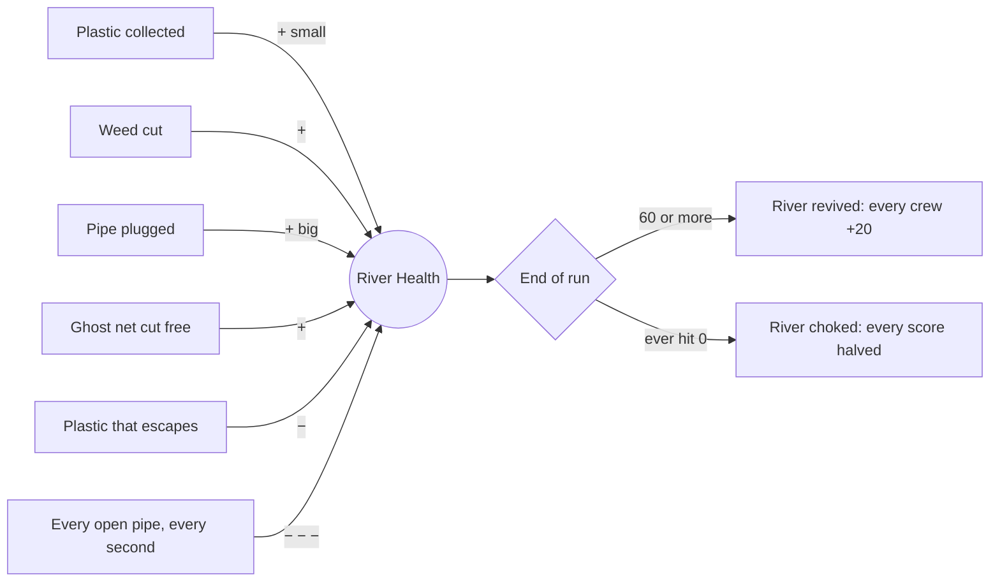
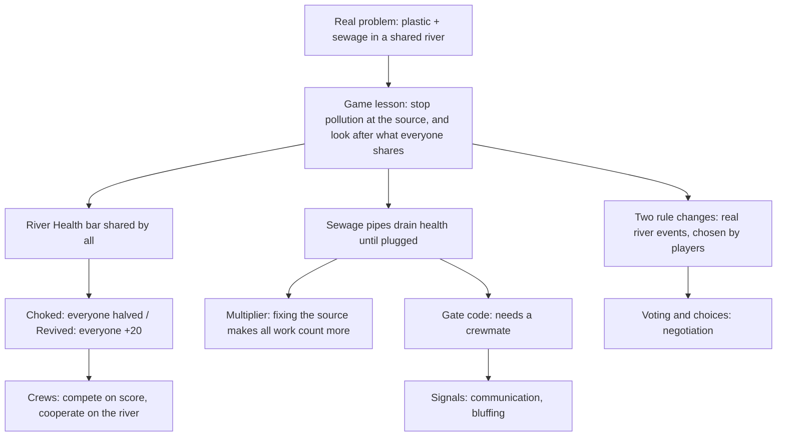

# Clearwater Run, explained from the start

This guide is for someone who has never seen the game. It starts with the real-world problem, then the
assignment, then walks through every feature: **what it is, why it is there, and what it teaches.** No game
experience is needed.

> **Where the exact numbers live:** the [Rule Book](RULE_BOOK.md) has every rule and number for players. The
> [Game Design Document](GAME_DESIGN.md) has the design reasoning. This guide explains the *ideas*.

---

## Contents

1. [The real problem: rivers choking on plastic and sewage](#1-the-real-problem-rivers-choking-on-plastic-and-sewage)
2. [The assignment, and how the game answers it](#2-the-assignment-and-how-the-game-answers-it)
3. [The game in one minute](#3-the-game-in-one-minute)
4. [What you see on screen](#4-what-you-see-on-screen)
5. [River Health: the most important idea](#5-river-health-the-most-important-idea)
6. [Everything on the river, and why it is there](#6-everything-on-the-river-and-why-it-is-there)
7. [The sewage pipe, explained properly](#7-the-sewage-pipe-explained-properly)
8. [Signals: talking without words](#8-signals-talking-without-words)
9. [Crews: working together and competing](#9-crews-working-together-and-competing)
10. [The two rule changes](#10-the-two-rule-changes)
11. [Score: how points work](#11-score-how-points-work)
12. [Capsizing, boost and other boats](#12-capsizing-boost-and-other-boats)
13. [The three rivers](#13-the-three-rivers)
14. [Around the game: hub, Seeds, boats, stars, missions, ranks](#14-around-the-game-hub-seeds-boats-stars-missions-ranks)
15. [Solo Endless](#15-solo-endless)
16. [Tutorial, settings and controls](#16-tutorial-settings-and-controls)
17. [Behind the scenes: the River Director (creator only)](#17-behind-the-scenes-the-river-director-creator-only)
18. [How it all fits together](#18-how-it-all-fits-together)
19. [Glossary](#19-glossary)
20. [Questions people ask](#20-questions-people-ask)

---

## 1. The real problem: rivers choking on plastic and sewage

Many rivers that flow through big, fast-growing cities face the same two problems.

**Plastic waste.** Bottles, bags and wrappers are dropped in streets and drains. Rain washes them into the river,
and the river carries them downstream to the sea. Plastic does not rot: it breaks into smaller and smaller pieces
that fish and birds swallow.

**Untreated sewage.** Cities produce huge amounts of waste water from toilets, kitchens and factories. Where there
are not enough treatment plants, or the pipes are broken or illegal, that waste water flows **straight into the
river through outfall pipes** in the riverbank. Sewage:
- uses up the oxygen in the water, so fish suffocate;
- feeds fast-growing weeds such as water hyacinth, which cover the surface and block sunlight;
- makes the water smell, look brown and spread disease.

**Why it keeps happening.** Everyone shares the river, but nobody owns it. Each person, business or town gains a
little by dumping waste ("someone else will deal with it"), and the cost is spread over everyone. When everyone
thinks that way, the river dies, and *everyone* loses. Economists call this the **tragedy of the commons**.

**The key insight the game is built on:** picking up plastic helps, but it is only cleaning up the *symptoms*. The
real fix is to **stop the pollution at its source**: plug the sewage pipes and stop new waste getting in. Cleaning
a river without stopping the pipes is like mopping the floor with the tap still running.

The game uses **no real place names**. It shows the problem in general; the presentation can connect it to a real
river.

---

## 2. The assignment, and how the game answers it

The brief asked for a game about **environmental awareness**, addressed **indirectly** (not a lecture), where:
- players **change the rules exactly twice** while playing;
- there is **cooperation, communication and negotiation**;
- there are **puzzles**;
- the rules are **simple**;
- the number of players is **limited**.

| The brief says | How Clearwater Run does it |
|---|---|
| Environmental awareness, indirectly | You never read a lecture. You *feel* the problem: missed plastic and open pipes make the shared river sicker, and a dead river cuts everyone's score in half. |
| Players change the rules exactly twice | Every run has a **Twist** (everyone votes) and a **Finale** (the losing crew picks). The game enforces exactly two. |
| Cooperation | Crewmates share one score. All crews share one River Health bar. |
| Communication | To plug a pipe, you need your crewmate to tell you a secret code, using only six symbols. |
| Negotiation and bluffing | The Twist vote is argued out loud. The rival crew can see your symbols, so you can send fake ones. |
| Puzzles | The gate code is a teamwork puzzle under time pressure. |
| Simple rules | Three buttons: steer, hop, action. A 60-second tutorial teaches everything. |
| Limited players | 2–4 players per room. |

---

## 3. The game in one minute

- You drive a small **cleanup boat** down a river. The boat moves forward **on its own**; you only steer left and
  right, **hop**, and press one **action** button.
- A run lasts **3 minutes**.
- You **collect plastic** by driving into it. You **cut weed**, **hop over logs**, and **plug sewage pipes**.
- There is one shared **River Health** bar for everybody. Pollution lowers it; cleaning raises it.
- With 3–4 players, you split into **two crews** that race for the higher score, while still sharing the same
  river.
- Twice per run, the players **change the rules**.
- At the end: scores, River Health, stars, and **Seeds** (the game's coins) to spend on boats.

---

## 4. What you see on screen

```
┌──────────────────────────────────────────────────────────────┐
│ YOUR CREW 37        2:14               RIVER HEALTH ████░ 72% │  ← score · timer · shared health
│ ♻ 30 · 🔧 1        Monsoon Surge                              │  ← plastic · pipes · active rule
│                                                              │
│                🔧 Sewage pipe ahead on the LEFT              │  ← prompts
│                                                              │
│                     ~ ~ river ahead ~ ~                       │
│                                                              │
│                        [ your boat ]                         │
│                                                              │
│ ◀ ▶ steer · ▲ hop      [ Boost ███░░ ]      1 2 3 4 5 6 signals│
└──────────────────────────────────────────────────────────────┘
```

- **Top left:** your crew's score, with plastic collected (♻) and pipes plugged (🔧) under it.
- **Top middle:** time left, and a badge for any rule change in force.
- **Top right:** **River Health**, shared by everyone on the river.
- **Middle:** helpful prompts ("pipe ahead", "debris wave ahead").
- **Bottom middle:** your **boost meter**.
- **Bottom right:** the six **signal** buttons. On a phone, thumb buttons also appear.

---

## 5. River Health: the most important idea

River Health is **one bar, shared by every player**, from 0 to 100. It starts at 70.



**Why it exists.** It turns the "tragedy of the commons" into a rule you can feel. Two crews can fight over points,
but if they both ignore the river, it chokes and **both** lose half their score. If either crew looks after the
river, **both** get the +20 bonus. Selfishness costs everyone; care helps everyone.

**What it teaches.** A shared resource only survives if someone pays attention to it, even while competing.

You can also *see* the health: the water turns from clear blue-green to murky brown as it drops.

---

## 6. Everything on the river, and why it is there

| Thing | What it does in the game | What to do | Why it is in the game |
|---|---|---|---|
| **Plastic** (bottles, bags) | +1 crew score, fills your boost, heals the river a little. If *every* boat passes it, it escapes downstream and hurts the river. | Drive into it. | The visible, everyday pollution. Picking it up is good, but small. |
| **Weed mat** (floating water weed with purple flowers) | Slows you down if you hit it. | Press **Action** just before it to cut it. Each cut "greens a bank": +5 score and the river heals. | Real sewage feeds weeds like water hyacinth that choke rivers. Clearing them helps the river breathe. |
| **Log** | Capsizes you (you stop briefly and spill plastic). A red shadow appears under a log in your lane when it's time to hop. | **Hop** over it. | A simple obstacle that makes steering and timing matter. |
| **Debris wave** (every 30 s) | A wall of floating junk across every lane but one (two gaps on a wide river). The gaps glow. | Steer to a gap, or hop. | Like the junk a storm or flood sweeps down a river. It forces quick decisions. |
| **Sewage pipe** (in the riverbank) | Pours brown murk and drains River Health **every second** until someone plugs it. | Pull up beside it, press **Action**, enter the **gate code**. | The source of the pollution. See the next section. |

---

## 7. The sewage pipe, explained properly

This is the heart of the game, so it gets its own section.

### What it is

Along the riverbanks there are **concrete outfall pipes**, like the real pipes that dump untreated sewage into
city rivers. In the game you see a grey pipe sticking out of the bank with a **brown plume** spreading into the
water.

### What it does

As soon as the leading boat comes within about 30 metres of it, **each open pipe drains River Health a little every
second**, and it keeps
draining until someone plugs it. Two open pipes drain twice as fast. Pipes never stop by themselves.

### Why it is in the game

Without pipes, the game would only be about collecting plastic, which teaches "cleaning up is enough". The pipe
adds the real lesson:

> **Stop pollution at its source, or the river never gets better.**

You can collect plastic all run long, but if pipes stay open, River Health keeps falling underneath you. Plugging a
pipe is the single biggest thing you can do for the river (+10 health at once, and it stops the drain for good).

### Why plugging is worth so many points

Each pipe your crew plugs raises your crew's **multiplier** for the rest of the run:

```
Crew score = plastic × (1 + 0.5 × pipes plugged) + 5 × banks greened
```

So with 1 pipe plugged, every piece of plastic is worth 1.5 points; with 2 pipes, 2 points. **Fixing the source
makes all your other work count for more.** That is the real-world idea in game form: stopping pollution at the
source makes every clean-up effort more effective.

### How you plug a pipe

1. **Spot it.** Open pipes have a big brown plume and a floating 🔧 marker with the distance. A card at the top
   of the screen says which bank (◀ LEFT or RIGHT ▶), how many metres away, and your next step.
2. **Get beside it.** Steer into the **outermost lane** on that side ("Move ◀ left to the edge lane").
3. **Press Action** when you're next to it ("Press ▼ NOW to plug it!"). Your boat **stops** while you work.
4. A **gate code** appears: three symbols, such as 🐟 ⭐ 💧. You have **8 seconds** to enter them in order with
   keys 1–6 (or by tapping the symbol buttons).
5. **Right code:** your boat stays put **one more second** while your crew member hammers the pipe shut (sparks
   and clanks). The brown plume stops, River Health +10, and a banner shows your new multiplier ("every plastic now
   ×1.5"). The ×1.5 badge stays next to your score.
   **Wrong code or too slow:** the pipe keeps pouring, and you can try again.

### The twist: you can't read your own code

- **You**, the boat at the pipe, see the right three symbols but **in the wrong order** (scrambled).
- Your **crewmate**, anywhere on the river, sees the code **in the right order**.
- The only way they can tell you is with the six **signals** (next section). They can't type words.

#### Worked example: Player A and Player B solve a code together

| Step | Player A (at the pipe) | Player B (crewmate, anywhere on the river) |
|---|---|---|
| 1 | Reaches the pipe and presses **Action**. The boat stops. | Gets a card: "A is plugging a pipe — tell them the order!" |
| 2 | Sees the code **scrambled**: 🍃 Leaf · ➜ Arrow · 🐟 Fish. Right symbols, wrong order. | Sees the **real order**: 🐟 Fish · 🍃 Leaf · ➜ Arrow. |
| 3 | Watches the space over B's boat. | Sends the symbols one by one: **3** (Fish), then **1** (Leaf), then **5** (Arrow). Each pops up over B's boat. |
| 4 | Types what B sent: **3, 1, 5**. | — |
| 5 | Correct: the boat stays put for 1 second while A's crew member hammers the pipe shut. The brown plume stops, River Health +10, and every plastic is now worth ×1.5. | Shares the score boost. |

A only ever needed **which order**: they could already see the three symbols. So B's job is just to send them in
order. Because the rival crew sees B's symbols too, a sharp crew agrees a trick in advance (for example "the
symbol I send twice is a fake").

**Playing alone (no crewmate).** It becomes a memory puzzle instead: the code is shown **in the real order for
2 seconds**, then turns into **? ? ?**, and you enter it from memory. This happens in Practice solo, Endless, and
for anyone whose crew is just them.

### Why the code works this way

This is the game's **puzzle** and its **communication** requirement in one. It also mirrors real life: fixing
pollution at the source is never a one-person job. It needs people **coordinating**: inspectors, councils,
engineers, communities. The person at the problem and the person with the information have to talk.

### The trade-off it creates

While you plug a pipe, your boat is **stopped**. You're not collecting plastic, and the other crew may pull ahead.
So every crew faces a real choice:
- **chase points now** (collect plastic), or
- **invest in the river** (plug the pipe), which pays back through the multiplier and protects the shared health
  bar.

That choice, "short-term gain or long-term fix", is exactly the choice people face with real pollution.

---

## 8. Signals: talking without words

There are six symbols: **1 Leaf 🍃, 2 Drop 💧, 3 Fish 🐟, 4 Bridge 🌉, 5 Arrow ➜, 6 Star ⭐.**

- Press a number key (or tap a symbol button) and that symbol pops up **over your boat** for everyone to see.
- The symbols have **no fixed meaning**. Your crew decides what they mean.

**Their main job:** passing on gate codes. Your crewmate reads the real order and sends, say, Fish, Star, Drop, and
you type those in.

**Why the rival crew can see them:** this creates **bluffing and negotiation**. Crews invent their own shorthand
("double-Leaf means the first symbol is Leaf"), or send fake signals to confuse the others. It makes
communication a skill, not just a button.

---

## 9. Crews: working together and competing

| Players | How crews form |
|---|---|
| 1 (practice) | You alone, against the river. |
| 2 | **One crew together**, against the river. |
| 3–4 | **Two rival crews.** Seats alternate: players 1 and 3 against players 2 and 4. |

- Crewmates **share one score**, so helping each other is always worth it.
- Crews **compete** on score, but **share River Health**.

**Why both at once?** Real environmental problems look like this: groups compete (businesses, towns, countries) but
all depend on the same shared resource. The game asks you to win **without** wrecking the thing everyone needs.

---

## 10. The two rule changes

Every run, the rules change **exactly twice**, and **players choose** both changes. Each one goes:
a 5-second warning → the game pauses → you choose → a card shows the new rule → racing resumes.

### Rule change 1: the Twist (about 1 minute in). Everyone votes.

| Twist | Good side | Bad side | Real-world idea |
|---|---|---|---|
| **Monsoon Surge** | Extra plastic to collect | Debris waves every 15 s instead of 30 s | Heavy rain washes far more waste into rivers |
| **Dry Season** | Fewer lanes to watch | A third of the lanes dry up, and pipes pour twice as fast | Low water concentrates pollution, so sewage does more damage |
| **Volunteer Day** | Each plastic counts double | Weed mats keep spreading | Community clean-ups make a big difference, but nature fights back |

A tie, or nobody voting, is settled by a **visible spin**, never secretly.

**Why a vote?** It's the **negotiation** part of the brief. Players argue out loud: "Dry Season will kill us, we
haven't plugged a pipe!" Different crews want different twists depending on how they play.

### Rule change 2: the Finale (about 2:20 in). The trailing crew picks.

| Finale | What it does |
|---|---|
| **Second Wind** | The picking crew's boost fills up, and extra plastic flows their way for 20 s. Good for catching up. |
| **Clean Sweep** | Every open pipe pours at half speed for the rest of the run. It helps **everyone**, including the leaders. |

**Why the losing crew picks:** it gives them a comeback chance. **Why offer Clean Sweep at all:** it is a real
moral choice. The losing crew can chase points for itself, or help the shared river even though the leaders benefit
too.

**What never changes:** the controls, the score formula and how you win. Only the river changes.

---

## 11. Score: how points work

```
Crew score = plastic × (1 + 0.5 × pipes plugged) + 5 × banks greened
```

**Example:** 40 plastic, 2 pipes plugged, 3 weed mats cut → 40 × 2 + 15 = **95**.

At the end:
- River Health 60 or more → **+20** for every crew (revived).
- River Health ever hit 0 → every score **halved** (choked).
- **Two crews:** the higher score wins. **One crew:** you "win" by keeping the river revived.

---

## 12. Capsizing, boost and other boats

**Capsize.** Hit a log or a debris wave without hopping, and your boat **flips over**:
- you stop for about **a second**;
- you **spill 3 plastic** just ahead of you, which anyone (including you) can collect again;
- then for **1 second** obstacles pass through you (your boat blinks), so you can't be knocked over twice in a row.

There's a short freeze, a screen shake and a red flash so it *feels* like a hit; these can be toned down in
Settings → Comfort.

*Why it works like this:* earlier versions stopped you for 2 seconds, which felt like a harsh punishment. Now it's
short, but costs you something you can win back, so a mistake stings without ruining your run.

**Boost.** Every piece of plastic fills your boost meter. When it's full, your boat **surges forward at 1.5× speed**
for 2.5 seconds, and weed can't slow you. *Why:* it rewards collecting with a fun burst of speed.

**Other boats.** If you run into the back of a boat in your lane, you slow down briefly. There is no attacking or
crashing into each other on purpose: the game has **no violence**.

**A wider river with more players.** One boat gets 3 lanes, 2 boats get 4, and 3–4 boats get 6. Wider rivers also
carry more plastic and more obstacles, so everyone has room and enough to collect.

---

## 13. The three rivers

Each river adds **one new thing** on top of everything before it. You choose the river from the button above PLAY
(in a crew room, the host chooses).

### Town Canal (available from the start)
Everything above: plastic, weed, logs, waves and pipes, between houses and footbridges.

### Mangrove Maze (unlocks after 3 runs or 3 stars)
- **New: ghost nets.** Old, abandoned fishing nets floating across **two lanes**, with plastic trapped inside.
- Hitting one slows you, like weed.
- Press **Action** **twice** to cut it free, or have a crewmate press once too. It releases 4 pieces of plastic and
  heals the river.
- **Real-world idea:** "ghost gear" (lost or dumped fishing nets) is one of the deadliest kinds of plastic in water.
  It keeps trapping fish and wildlife for years.
- **Why two cuts:** it encourages crewmates to work together on the same net.

### Rapids Gorge (unlocks after 8 runs or 7 stars)
- **New: currents.** White arrows on the water that **push your boat one lane sideways**, unless you hop over them.
- **New: rocks.** Like logs, but you **can't hop** them: you must steer around.
- **Why:** fast water is harder to control. It tests skill, and pairs nicely: a current might push you towards a
  rock.

Two more rivers (Night Delta and Harbour Port) are designed for later.

---

## 14. Around the game: hub, Seeds, boats, stars, missions, ranks

The **hub** is the main menu: a big PLAY button, side tiles, and your Seeds.

| Feature | What it is | Why it is there |
|---|---|---|
| **PLAY** | Opens a crew room with a 6-letter invitation code. Friends type it to join. | How multiplayer starts. |
| **Practice solo** | A run on your own. Pays half Seeds. | Learn and improve without friends online. |
| **∞ Endless** | A solo survival mode (section 15). | A personal-best challenge. |
| **Seeds** 🌱 | The only currency. **Earned by playing, never bought.** | Reward without unfairness: no real money anywhere. |
| **Garage** | Choose which boat you sail. | Personal style and small upgrades. |
| **Shop** | Spend Seeds on boats. Undo any purchase within 10 minutes. | Something to save towards; no regret. |
| **Boats** | Seven boats with four stats: speed, net, cutter, boost. Better boats are only slightly better. | Variety, without letting new players fall hopelessly behind. |
| **Daily reward** | Collect Seeds once a day. Missing a day pauses the track; it never resets. | Gentle reason to come back, without pressure. |
| **River Road** | Rewards for runs completed, including two boats. | A sense of progress. |
| **Stars** ★ | Each river has 3: clean river (health 60+), a score target, and the river's own goal (plug every pipe / free 3 nets / no capsizes). Once earned, kept forever. | Clear goals that make you play differently. Stars also unlock rivers. |
| **Best score** | Your best crew score on each river. | Beat yourself. |
| **Daily missions** | Three new goals each day, such as "Plug 2 sewage pipes". Each pays 20–40 Seeds when done. | Nudges you to try every part of the game, not repeat one routine. |
| **Rank** | Rookie → Deckhand → Skipper → Captain → River Guardian, based on how well you play. Drops at most one step a day. | A long-term goal that grows with skill. |

**Why no real money?** The game borrows the *good* parts of mobile games (a hub, rewards, goals) but leaves out the
predatory parts: no loot boxes, no paid shortcuts, no punishment for missing a day.

---

## 15. Solo Endless

A survival mode for one player:
- **No time limit**, but **one capsize ends the run**.
- Your boat speeds up 2% every 15 seconds, so it gets harder and harder.
- The rules still change **exactly twice**, and you choose (Twist at 1:00, Finale at 2:30).
- **Score = metres travelled + 5 per plastic.** Each river keeps your best.
- Pays like practice; counts for missions; earns no stars.

**Why it exists:** after a few wins, players want a "how far can I go?" challenge. "One hit and you're out" is
exciting alone, but would feel unfair in crew races, so it lives in its own mode.

---

## 16. Tutorial, settings and controls

### Tutorial (60 seconds, skippable)
A scripted short river that teaches one thing at a time: steer, the boost meter, River Health, hop, cut weed, plug
a pipe, and send a signal. Each step **spotlights** the button or meter it's about, with a dimmed screen, a pulsing
ring, a tapping hand and a speech bubble, like the guided tours in big mobile games. You learn by doing, not
reading.

### Controls

| Action | Keyboard | Phone / tablet |
|---|---|---|
| Steer | ◀ ▶ or A / D | ◀ ▶ buttons or swipe left/right |
| Hop | ▲, W or Space | ▲ button or swipe up |
| Action (cut, plug) | ▼, S or E | ✂ button or swipe down |
| Signals | keys 1–6 | the six symbol buttons |
| Vote | keys 1–3 | tap a card |

A gamepad works too.

### Settings
- **Graphics quality:** Low / Medium / High, for slower laptops.
- **Sound:** master volume, music, effects, mute.
- **Comfort:** screen-shake strength and "reduce flashing".
- **On-screen controls:** buttons + swipes (phone default), buttons only, swipes only, or off (PC default). Button
  size and a left-handed layout.
- **Keys:** change the letter keys (arrow keys always work).

---

## 17. Behind the scenes: the River Director (creator only)

> **Keep this out of player-facing material** (the rule book, the game screens). It is documented for you, in
> [GAME_DESIGN.md §5.1](GAME_DESIGN.md), and in the design spec.

The **River Director** quietly adjusts the difficulty so every room stays fun: never boringly easy, never hopeless.

- **It learns your skill.** After each run, the server scores how well you played (plastic share, capsizes, pipes
  plugged, river health) and nudges your hidden skill rating. It works like chess ratings.
- **It sets the river.** Before a run, the room's average rating picks a difficulty: more logs, weed and pipes
  and slightly less plastic for strong players, the opposite for beginners.
- **It adapts in solo and co-op runs** every 10 seconds, by small steps only.
- **It never interferes in crew-vs-crew races**, so it can't secretly help one side.
- It never touches points, rewards or the shop.
- Every run is logged, so a real machine-learning model could be trained on it later.

Your **rank** (section 14) is built on this rating, but players only ever see the rank name, never the number.

---

## 18. How it all fits together



In one sentence: **Clearwater Run is a fast boat race where the only way to really win is to protect the river you
all share, and the biggest thing you can do for it is stop the pollution at its source, which you can only do by
working with your crew.**

---

## 19. Glossary

| Word | Meaning |
|---|---|
| **Run** | One 3-minute race down the river. |
| **Lane** | One of the 3–6 tracks across the river your boat moves between. |
| **Crew** | The team you're on. Crewmates share a score. |
| **River Health** | The shared 0–100 bar for how clean the river is. |
| **Choked** | River Health hit 0: every score is halved. |
| **Revived** | River Health ended at 60+: every crew gets +20. |
| **Outfall / sewage pipe** | A pipe in the bank pouring waste water into the river. |
| **Gate code** | The three-symbol code you enter to plug a pipe. |
| **Signal** | One of six symbols you can show over your boat. |
| **Multiplier** | How much each plastic is worth; raised by plugging pipes. |
| **Banks greened** | Weed mats cut: +5 each. |
| **Capsize** | Your boat flips after hitting a log or wave. |
| **Boost** | A short burst of speed, charged by collecting plastic. |
| **Twist / Finale** | The two player-chosen rule changes in each run. |
| **Ghost net** | An abandoned fishing net (Mangrove Maze). |
| **Current** | Moving water that pushes you sideways (Rapids Gorge). |
| **Seeds** | The game's coins, earned only by playing. |
| **Stars** | Three goals per river, kept once earned. |
| **Endless** | Solo mode: no clock, one capsize ends it. |
| **Host** | The player who opened the room and starts the run. |

---

## 20. Questions people ask

**Why does my score drop even though I'm collecting plastic?**
It doesn't drop during the run, but River Health might be falling because of open pipes. If it reaches 0, everyone's
final score is halved. Plug pipes!

**Why can't I see the gate code properly?**
On purpose: you see the right symbols in the wrong order. Your crewmate sees the real order and must signal it to
you. That's the teamwork puzzle.

**Should I always plug pipes?**
Usually yes: each one heals the river by 10, stops the drain for good, and makes every future plastic worth more.
But your boat stops while you plug, so timing matters.

**What if I'm playing alone?**
Use Practice solo or Endless. When you plug a pipe alone, the code shows in the real order for 2 seconds, then hides as ? ? ?; enter it from memory.

**Why can the other crew see our signals?**
To allow bluffing. Invent a shorthand with your crewmate, or send decoys.

**Is the rule change random?**
No. Players choose both. Only a tie or no choice is settled by a spin, and the spin is shown on screen.

**Can I pay to win?**
No. There is no real money. Better boats are only slightly better.

**Why does the river look brown?**
The water colour follows River Health. Clear blue-green means healthy; murky brown means it's dying.
